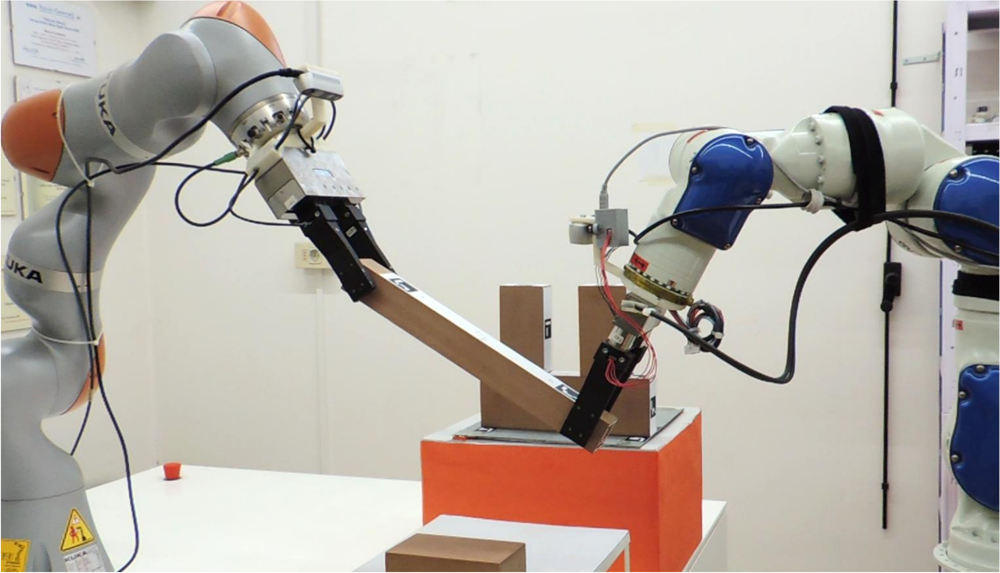
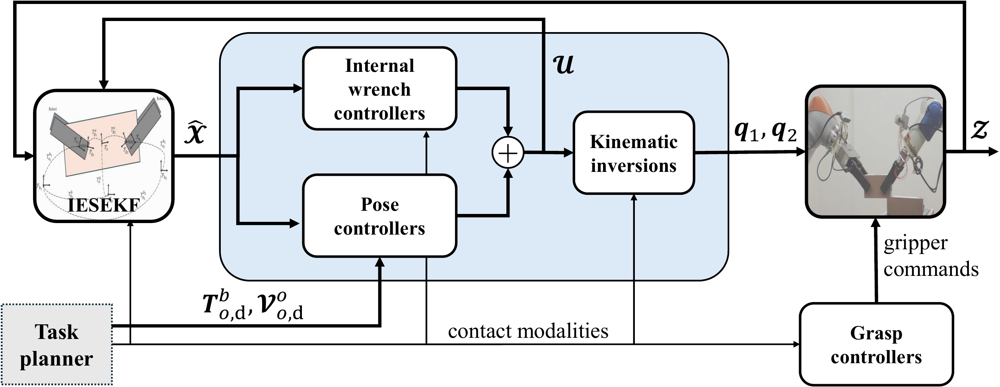
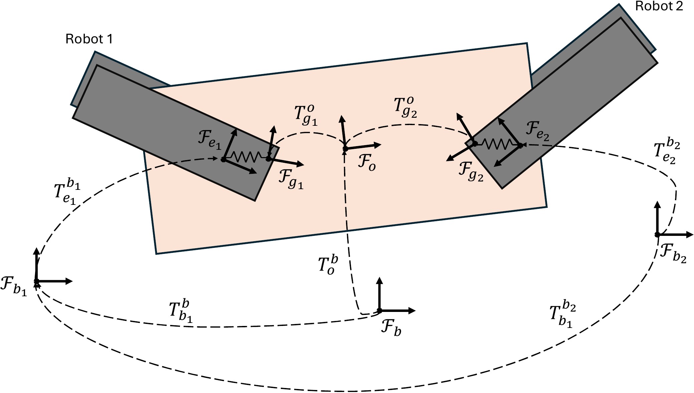
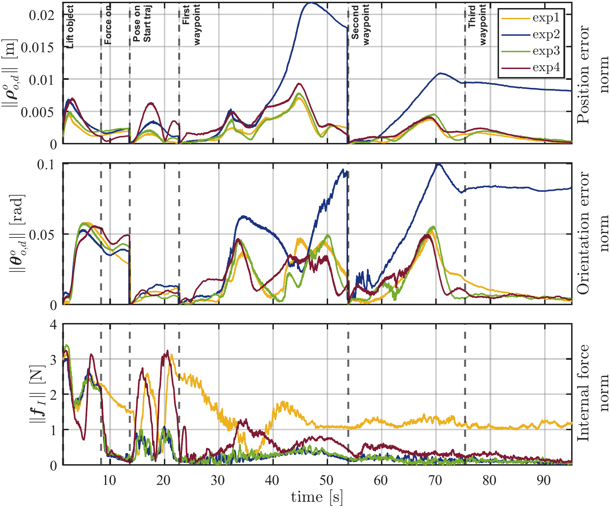
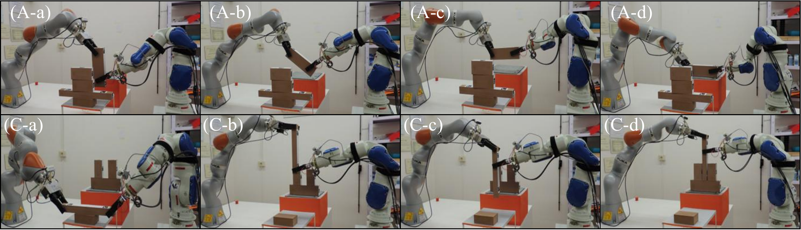

# Cooperative Object Transport and Assembly: Pose/Force Control by Visual-Tactile Feedback

**Marco De Simone, Marco Costanzo, Giuseppe De Maria, Ciro Natale**
Dipartimento di Ingegneria, Università degli Studi della Campania "Luigi Vanvitelli", Aversa, Italy

*IEEE Robotics and Automation Letters, vol. 11, no. 4, pp. 4315–4322, 2026* &nbsp;·&nbsp; [Paper (DOI: 10.1109/LRA.2026.3665445)](https://doi.org/10.1109/LRA.2026.3665445) &nbsp;·&nbsp; [Video](https://www.youtube.com/watch?v=tdJzSiXsvN8)

<p align="center">
  <a href="https://www.youtube.com/watch?v=tdJzSiXsvN8"></a>
</p>

<p align="center">
  
</p>

This repository contains the **simulation release** of the control framework presented in the paper. You can run the full estimation and control pipeline (IESEKF on SE(3), pose controllers, internal wrench controllers, kinematic inversion and task sequencing) on two simulated heterogeneous robots: a KUKA LBR iiwa 7 and a Yaskawa Motoman SIA5F. They cooperatively transport a block grasped through soft (elastic) contacts.

> **Scope.** This is a demonstration package. The hardware-specific pieces used in the experiments are **not** included:
> - robot drivers
> - RealSense / ArUco perception
> - WSG grippers with SUNTouch tactile sensors
> - the slipping/pivoting grasp controller
>
> A robots–spring–object simulator replaces them. It generates the same measurements the filter receives on the real setup: robot forward kinematics, contact wrenches and visual object poses.

---

## Overview

The goal is to have two robots manipulate a common workpiece so that it tracks a reference trajectory while the internal stress on it stays small.

- **Visual-tactile sensor fusion on SE(3).** A discrete-time Iterated Error-State Kalman Filter (IESEKF), designed on the SE(3) manifold, fuses the following measurements:
  - each robot's forward kinematics
  - the contact wrenches measured at the fingertips
  - the object poses observed by the eye-in-hand cameras

  From these it estimates the object pose and twist, the grasp frames, and the internal wrenches. It also calibrates the **relative pose between the robot bases** online. All estimated quantities stay consistent on SE(3) with no simplifying assumptions.
- **Soft contact model.** Each finger-object contact is modeled as an elastic displacement (6-D spring-damper) in SE(3). This keeps the model kinetostatically consistent with the robot motions on the same manifold.
- **Cooperative pose/force control.** Two controllers run together:
  - *pose controllers* track the desired object trajectory;
  - *internal wrench controllers* drive the estimated internal wrenches to zero.

  Their twists are summed and mapped to joint velocities by a kinematic inversion that also handles the redundant degrees of freedom created by in-hand pivoting or sliding, through selection matrices.

<p align="center">
  
</p>

<p align="center">
  
</p>

---

## Repository structure

```
uclv_dual_arm_control/
├── dependencies.repos              # external source dependency (IKFoM, vcs import)
├── dual_arm_control_interfaces/    # messages, services and actions (EKF init, trajectories, end effector, ...)
└── dual_arm_control/
    ├── src/
    │   ├── robot_kinematics_node.cpp               # kinematic simulation of one arm (Pinocchio)
    │   ├── trajectory_generator_node.cpp           # quintic joint / Cartesian trajectories (actions)
    │   ├── ekf_server_ikfom.cpp                    # IESEKF on SE(3)
    │   ├── ros_simulator_ikfom.cpp                 # robots-spring-object simulator
    │   ├── pose_control_node_single.cpp            # object pose controller (one per robot)
    │   ├── internal_force_control_node_single.cpp  # internal wrench controller (one per robot)
    │   ├── sum_twist_node.cpp                      # sums pose + force control twists
    │   ├── force_placement_node.cpp                # force-guarded placement of the object
    │   ├── demo_node.cpp                           # task sequencer (reads config/*.yaml)
    │   └── tf_publisher_from_topic.cpp             # TF visualization helper
    ├── ekf_ikfom/        # SE(3)/SO(3) utilities, manifold definitions, process & output models
    ├── include/          # geometry / YAML helpers, quintic polynomial, trajectory action clients
    ├── launch/           # simulation launch files
    ├── config/           # object, simulator and task configuration
    ├── urdf/ meshes/     # iiwa + WSG50 and SIA5F + WSG32 models (see meshes/LICENSES.md)
    ├── rviz/             # RViz configuration
    └── plotjuggler/      # PlotJuggler layout to inspect the simulation
```

### Main nodes

| Node | Role | Main inputs | Main outputs |
|---|---|---|---|
| `robot_kinematics_node` | Kinematic simulation of one arm with Pinocchio: joint integrator, inverse differential kinematics in the end-effector frame (selection matrix + null-space joint controller), forward kinematics | `twist_body`, `command/joint_states` | `joint_states`, `fkine`, `command/fkine_twist_tactile_sensor_body_frame` |
| `trajectory_generator_node` | Quintic joint and Cartesian trajectories as ROS 2 actions (one per robot, one for the object) | `generate_joint_trajectory`, `generate_cartesian_trajectory` actions | `command/joint_states`, `cartesian_traj/pose`, `cartesian_traj/twist` |
| `ros_simulator_ikfom` | Integrates the robots–spring–object model and generates the measurements | `/robotN/command/fkine_twist_tactile_sensor_body_frame` | `/robotN/fkine_simulator`, `/robotN/wrench`, `/robotN/<object>/<marker>/pose`, ground truth (`object_pose`, `b2Tb1_simulator`, `oTgN_simulator`) |
| `ekf_server_ikfom` | IESEKF on SE(3): object pose/twist, grasp frames, robot-robot calibration, internal/external wrenches | fkine, wrenches, marker poses | `/ekf/object_pose`, `/ekf/object_twist`, `/ekf/b1Tb2_filtered`, `/robotN/internal_wrench`, `/robotN/eeTo_topic`, `/ekf/external_wrench_estimate` |
| `pose_control_node_single` | Object pose controller (one per robot) | `/ekf/object_pose`, `/desired_object_pose`, `/desired_object_twist` | `twist_body_pose` |
| `internal_force_control_node_single` | Internal wrench controller (one per robot) | `internal_wrench` | `twist_body_force` |
| `sum_twist_node` | Sums the two control actions | `twist_body_pose`, `twist_body_force` | twist command to the kinematic inversion |
| `force_placement_node` | Lowers the object until the estimated external wrench detects contact | `/ekf/external_wrench_estimate` | `/desired_object_twist` |
| `demo_node` | Executes the task in `config/task_resin_block_3.yaml` (homing, EKF init, approach, grasp, lift, controlled transport, internal motion, placement, release) | – | service calls / trajectories |

`launch/single_robot.launch.py` starts `robot_state_publisher`, `robot_kinematics_node`, `trajectory_generator_node` and an end-effector pose controller for each robot.

The robot URDFs (`urdf/iiwa7_macro.xacro`, `urdf/sia5d_macro.xacro`) follow the Denavit–Hartenberg models of the controllers exactly. The arm meshes come from public description packages; see [`meshes/LICENSES.md`](dual_arm_control/meshes/LICENSES.md).

---

## Requirements

- Ubuntu 24.04 + **ROS 2 Jazzy**, the tested configuration for this release. The experiments in the paper ran on Ubuntu 22.04 + ROS 2 Humble.
- System packages, installed with `rosdep`: [Pinocchio](https://github.com/stack-of-tasks/pinocchio) (`ros-jazzy-pinocchio`), `eigen`, `yaml-cpp`, `xacro`, `robot_state_publisher`, `rviz2`.
- One source package, listed in [`dependencies.repos`](dependencies.repos): [IKFoM](https://github.com/Marco19987/IKFoM) (`ikfom_toolkit`), the error-state Kalman filter on manifolds. It is a fork of [hku-mars/IKFoM](https://github.com/hku-mars/IKFoM) packaged for ROS 2.

---

## Build

```bash
mkdir -p ~/dual_arm_ws/src && cd ~/dual_arm_ws/src
git clone https://github.com/Marco19987/uclv_dual_arm_control.git
vcs import < uclv_dual_arm_control/dependencies.repos

cd ~/dual_arm_ws
rosdep install --from-paths src/uclv_dual_arm_control --ignore-src -r -y
colcon build --symlink-install --packages-up-to dual_arm_control
source install/setup.bash
```

> Use `--packages-up-to dual_arm_control`. The IKFoM repository also contains ROS 1 sample packages that do not build with colcon.
>
> If you use conda, deactivate it before building (`conda deactivate`). The ROS 2 interface generators need the system Python.

---

## Run the simulation

### One command

```bash
ros2 launch dual_arm_control simulation.launch.py
```

This starts the robots, the simulator, the IESEKF, the placement node and the task sequencer, then runs the whole task automatically: approach, grasp, lift, cooperative transport, placement and release. Watch it in RViz.

| Launch argument | Default | Meaning |
|---|---|---|
| `internal_force_control` | `true` | enable the internal wrench controllers |
| `object_pose_control` | `true` | enable the object pose controllers |
| `auto_continue` | `true` | execute the task without waiting for ENTER |
| `auto_continue_delay` | `2.0` | pause [s] between task steps in auto mode |
| `start_demo` | `true` | start the task sequencer (`demo_node`) |

For example, `ros2 launch dual_arm_control simulation.launch.py internal_force_control:=false` runs the transport with pose control only (exp1 in the paper).

To step through the task yourself, start everything except the sequencer:
```bash
ros2 launch dual_arm_control simulation.launch.py start_demo:=false
```
Then, in a second terminal, run `ros2 run dual_arm_control demo_node true true true true false false true` and press **ENTER** at each step.

### Step by step (separate terminals)

Open five terminals, source `install/setup.bash` in each, and run the following, in order:

```bash
# 1. Two simulated robots: kinematics, kinematic inversion, controllers, object trajectory generator, RViz
ros2 launch dual_arm_control two_robots_v2.launch.py

# 2. Robots-spring-object simulator (provides measurements and ground truth)
ros2 launch dual_arm_control launch_ros_simulator.launch.py

# 3. IESEKF on SE(3)
ros2 launch dual_arm_control bringup_ekf_server.launch.py

# 4. Force-guarded placement node
ros2 launch dual_arm_control launch_force_placement_node.launch.py

# 5. Task sequencer
ros2 run dual_arm_control demo_node true true true true false false true
```

`demo_node` takes seven positional boolean arguments:

| # | Argument | Value in the demo | Meaning |
|---|---|---|---|
| 1 | `use_internal_force_control` | `true` | enable the internal wrench controllers |
| 2 | `use_object_pose_control` | `true` | enable the object pose controllers |
| 3 | `use_ekf` | `true` | initialize and use the IESEKF |
| 4 | `use_estimated_b1Tb2` | `true` | use the online-calibrated relative pose of the robot bases |
| 5 | `use_pivoting` | `false` | real setup only (grasp controller), ignored here |
| 6 | `use_aruco` | `false` | real setup only (camera pipeline), ignored here |
| 7 | `simulation` | `true` | use the robots–object simulator |

Setting arguments 1 and 2 reproduces the controller combinations of the paper's experiments:
- `false true` → exp1, pose control only
- `true false` → exp2, internal wrench control only
- `true true` → exp3, both controllers

The task is in [`config/task_resin_block_3.yaml`](dual_arm_control/config/task_resin_block_3.yaml), and the sequence of tasks is in [`config/construction_configurations.yaml`](dual_arm_control/config/construction_configurations.yaml). Steps marked `wait_for_enter: True` wait for you to press **ENTER** in the `demo_node` terminal. In simulation, `scale_time_simulation` speeds up all trajectories (default 0.25).

To inspect the results, open PlotJuggler with the layout in `plotjuggler/simulation_controls.xml`, or compare these topics:
- `/ekf/object_pose` with `/desired_object_pose`, for pose tracking;
- `/ekf/object_pose` with the simulator ground truth `/object_pose`, for estimation accuracy;
- `/robot1/internal_wrench` and `/robot2/internal_wrench`, for internal stress.

### Troubleshooting

- **`Failed to find a free participant index` (CycloneDDS).** The demo starts many processes. On a machine without a multicast-capable interface, raise the participant limit:
  ```bash
  export CYCLONEDDS_URI="<CycloneDDS><Domain><Discovery><ParticipantIndex>auto</ParticipantIndex><MaxAutoParticipantIndex>200</MaxAutoParticipantIndex></Discovery></Domain></CycloneDDS>"
  ```

---

## Parameters

The parameters used in the paper are already set in the launch and configuration files.

| Quantity | Paper value | Where |
|---|---|---|
| Filter sample time | 4 ms | `launch/bringup_ekf_server.launch.py` (`sample_time`) |
| State covariance (object pose, end effectors / twist / calibration / grasps) | diag(1,1,1,10,10,10)·{1e-8, 1e-6, 1e-7, 1e-9} | `covariance_state_diagonal` |
| Measurement covariance (fkine / wrench / visual) | see Table I of the paper | `covariance_measure_diagonal` |
| Contact stiffness K₁, K₂ | diag(5641, 5641, 4400, 1.28, 1.28, 1.28) | `config/config.yaml`, `config/config_sim.yaml` |
| Contact damping | diag(50, 50, 50, 0.5, 0.5, 0.5) | `config/config.yaml`, `config/config_sim.yaml` |
| Wrench control gain, robot 1 | diag(0.001, 0.001, 0.001, 0.02, 0.02, 0.02) | `launch/two_robots_v2.launch.py` |
| Wrench control gain, robot 2 | diag(0.0005, 0.0005, 0.0005, 0.01, 0.01, 0.01) | `launch/two_robots_v2.launch.py` |
| Pose control gains | diag(0.3, 0.3, 0.3, 0.2, 0.2, 0.2) | `launch/two_robots_v2.launch.py` |
| Robot rates | iiwa 200 Hz, SIA5F 50 Hz | `launch/two_robots_v2.launch.py` |

To test robustness to wrong contact stiffness (exp4 in the paper), change the spring stiffness used by the filter in `config/config.yaml` and keep the simulator's stiffness in `config/config_sim.yaml` unchanged.

---

## Experimental results (from the paper)

The real-robot experiments compare the following controller configurations during the transport of block A:
- pose control only (exp1)
- internal wrench control only (exp2)
- both controllers (exp3)
- both controllers with altered contact stiffness (exp4)

<p align="center">
  
</p>

The full building assembly (blocks A, B1, B2, C) relies on in-hand pivoting and on an online switch from pivoting to sliding. It reaches sub-millimetre positioning, with angular errors between 0.13° and 1.5°.

<p align="center">
  
</p>

---

## Citation

If you use this code, please cite:

```bibtex
@ARTICLE{11397357,
  author={De Simone, Marco and Costanzo, Marco and De Maria, Giuseppe and Natale, Ciro},
  journal={IEEE Robotics and Automation Letters},
  title={Cooperative Object Transport and Assembly: Pose/Force Control by Visual-Tactile Feedback},
  year={2026},
  volume={11},
  number={4},
  pages={4315-4322},
  doi={10.1109/LRA.2026.3665445}}
```

## Acknowledgements

This work was supported by the MUR within PRIN2022 PNRR under Grant P2022MHR5C (DARC Project).
The filter is built on the [IKFoM](https://github.com/hku-mars/IKFoM) toolkit.

## License

Released under the Apache License 2.0. See [LICENSE](LICENSE).
